# Nimbus — Architecture Deep Dive

> A personal **notification service project** written in Go. It accepts notification
> requests over REST and gRPC, persists them in PostgreSQL, and dispatches them across **email, SMS, and
> webhook** channels with retries, dead-lettering, idempotency, rate limiting, circuit breaking,
> and an optional **AI/RAG** layer for natural-language operations.

This document is the canonical system-design reference. It is written as an **onboarding and
design guide** — every major decision includes the *why* and the *tradeoff*, not just the *what*.

> Want the **code-level** mechanics instead of the diagrams — how each subsystem actually works, line
> by line, explained from first principles? See the [Engineering Internals guide](INTERNALS.md).

---

## Table of Contents

1. [System at a Glance](#1-system-at-a-glance)
2. [C4 Level 1 — System Context](#2-c4-level-1--system-context)
3. [C4 Level 2 — Container View](#3-c4-level-2--container-view)
4. [C4 Level 3 — Internal Components](#4-c4-level-3--internal-components)
5. [Data Model (ERD)](#5-data-model-erd)
6. [Request Lifecycle — Create a Notification](#6-request-lifecycle--create-a-notification)
7. [Delivery: the hybrid worker](#7-delivery-the-hybrid-worker)
8. [Notification State Machine](#8-notification-state-machine)
9. [Reliability Patterns](#9-reliability-patterns)
10. [gRPC & Server-Streaming](#10-grpc--server-streaming)
11. [The AI / RAG Subsystem](#11-the-ai--rag-subsystem)
12. [Deployment Topology (AWS)](#12-deployment-topology-aws)
13. [Scaling & Capacity Planning](#13-scaling--capacity-planning)
14. [Failure Modes & Mitigations](#14-failure-modes--mitigations)
15. [Key Design Decisions & Tradeoffs](#15-key-design-decisions--tradeoffs)
16. [Design Principles Summary](#16-design-principles-summary)

---

## 1. System at a Glance

Nimbus separates **accepting a notification** from **attempting delivery**. An accepted request
has a row in PostgreSQL; workers attempt delivery and record its status, schedule a retry, or move
it to the database dead-letter queue. This is a project implementation, not a claim of measured
production volume or a delivery SLA.

| Concern | How Nimbus handles it |
|---|---|
| **Durable acceptance** | A successful create response follows the Postgres insert. The notification row is both application state and pending work. |
| **Bounded retries** | An optional SQS consumer and a DB-poll worker share dispatch logic. Failed attempts are scheduled again, up to the configured attempt limit, then dead-lettered when the outcome can be persisted. |
| **Claim coordination** | The batch poller uses `FOR UPDATE SKIP LOCKED`; the SQS consumer uses a conditional update by ID. These coordinate active claims, but a provider-side effect and the DB status update are separate operations. Duplicate delivery remains possible. |
| **Request deduplication** | The REST path uses Redis reservations and cached responses within a TTL. This protection is unavailable when Redis is unavailable and is not a durable uniqueness constraint. |
| **Tenant identifiers** | Rows and Redis keys carry tenant IDs. gRPC validates tenant ownership; the REST routes do not provide the same authentication boundary. The REST rate limiter uses a supplied tenant header or query parameter. |
| **Downstream resilience** | Each channel sender is wrapped in a circuit breaker that fails fast when a provider is down. |
| **Dead-letter recovery** | On reaching the attempt limit, the dispatcher moves the notification to a database dead-letter table for inspection, retry, or discard. |
| **Observability** | Prometheus metrics, structured zap logs, health + circuit-status endpoints. |
| **Operability via natural language** | Optional AI compose endpoint + a RAG pipeline that answers questions grounded in your own data. |

**Tech stack:** Go 1.23 · Chi (HTTP) · gRPC + Protobuf · PostgreSQL + pgvector · Redis · AWS
(SES / SNS / SQS) · Prometheus · Docker · Terraform (ECS Fargate).

---

## 2. C4 Level 1 — System Context

Who talks to Nimbus, and what does Nimbus talk to?

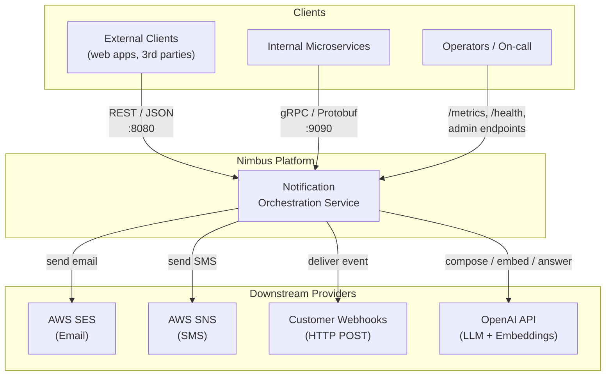

**Design note:** REST provides JSON endpoints; gRPC provides typed RPCs and streaming. Both write
to the same repository and use the same background delivery paths. Their middleware differs:
gRPC has token-to-tenant authentication; Redis request deduplication and rate limiting are wired
into REST. The REST interface needs authentication and authorization before untrusted exposure.

---

## 3. C4 Level 2 — Container View

Zooming in: the deployable units and the stateful systems they depend on. The API process and the
worker run **in the same binary today** as goroutines. Splitting them into independent deployments
would require separate startup configuration or entry points.

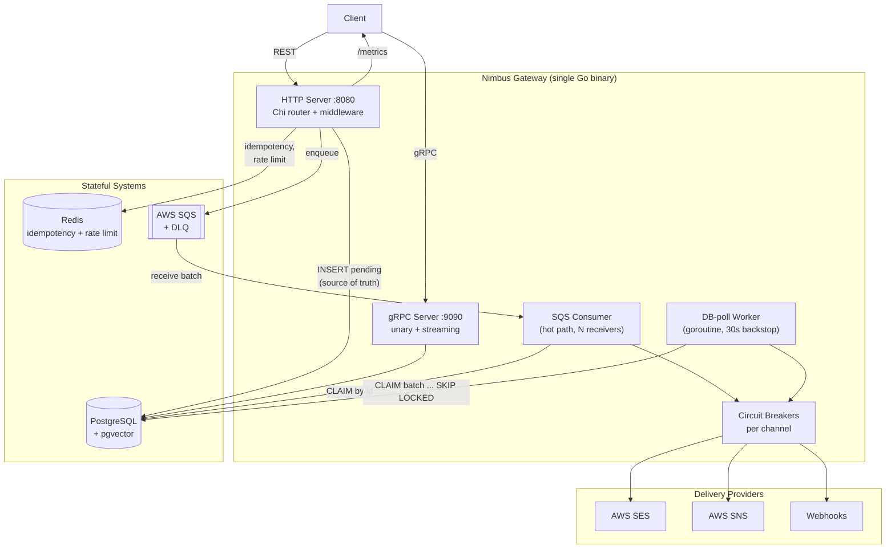

**Key insight (database-backed work queue):** the HTTP handler writes the Postgres row first,
then attempts an SQS enqueue when configured. The enqueue call is synchronous; it can add response
latency, but an enqueue error is logged rather than changing the successful insert into an HTTP
error. The DB-poll worker can claim due rows without an SQS message. SQS provides an event-driven
pickup path; measured pickup latency depends on the workload and environment.

Both delivery paths coordinate through database claims. This prevents a straightforward
read-then-write claim race, but does not make a provider send and its database status update atomic.
The crash window is explained in [section 7](#the-external-side-effect-boundary).

---

## 4. C4 Level 3 — Internal Components

The Go package layout maps cleanly onto responsibilities. Arrows show compile-time dependencies.

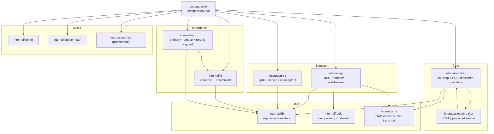

**Design note:** Each consumer defines its own narrow repository interface (e.g. the gRPC
server's `NotificationRepository` only declares the two methods it needs). That's interface
segregation — it keeps packages loosely coupled and trivially mockable in tests.

---

## 5. Data Model (ERD)

Three tables carry the system. Each has a tenant identifier; that data model alone does not
enforce authorization on every endpoint.

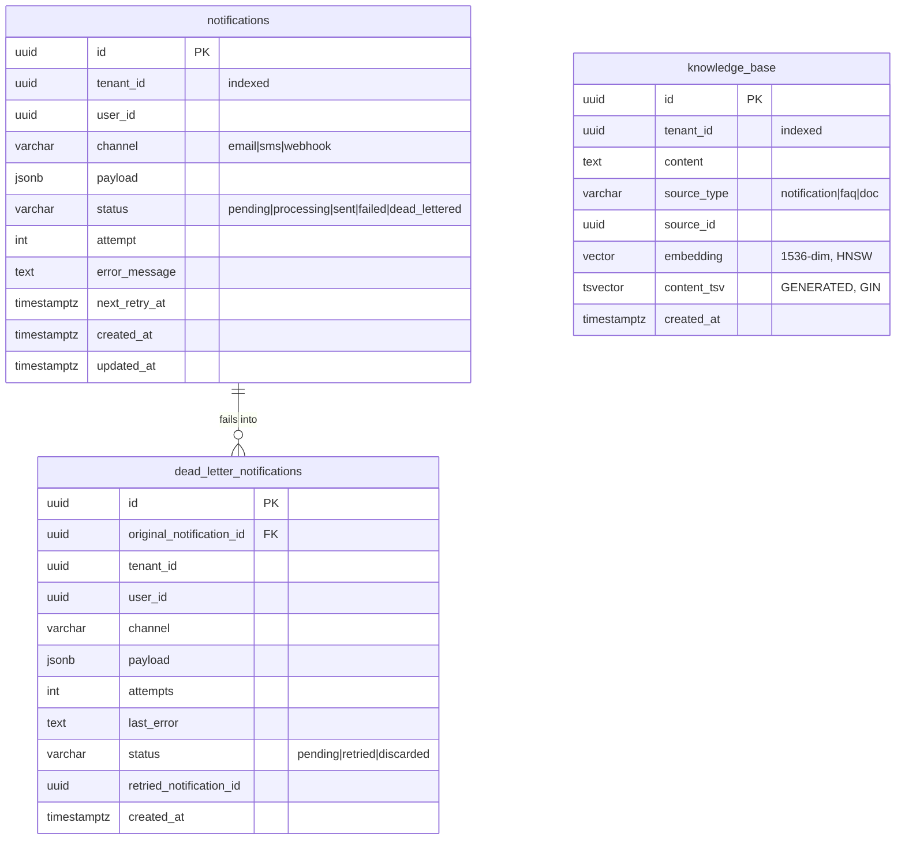

**Indexing strategy:**

- `idx_notifications_claimable` orders pending and processing rows by eligibility, creation time and ID. The poller range-scans due work. Terminal notifications occupy no entries. The older status/retry index remains available during an application rollout.
- `idx_notifications_tenant (tenant_id, created_at DESC)` — powers tenant list views with no sort.
- `knowledge_base` carries **two** ANN/search indexes: an **HNSW** index for vector similarity and a
  **GIN** index on the generated `content_tsv` column for full-text — this is what makes *hybrid*
  retrieval possible in a single SQL query.

---

## 6. Request Lifecycle — Create a Notification

This diagram follows a new valid REST request with no cached idempotency result. Rate limiting
and request deduplication apply when their Redis services are configured; a cached request can
return earlier without creating another row.

```mermaid
sequenceDiagram
    autonumber
    participant C as Client
    participant H as API Handler
    participant R as Redis
    participant DB as Postgres
    participant Q as SQS
    C->>H: POST /v1/notifications
    H->>R: Check rate limit when tenant key is supplied
    H->>H: Validate UUIDs, channel, JSON
    H->>R: CheckOrReserve idempotency key
    H->>DB: INSERT notification (status=pending)
    alt insert fails
        H->>R: Release(key)
        H-->>C: 500
    else insert succeeds
        H->>R: Store idempotency result
        opt SQS producer configured
            H->>Q: Enqueue (synchronous call)
            Q-->>H: Message ID or error
            Note over H: Log enqueue errors; keep the stored row
        end
        H-->>C: 201 Created with notification ID
    end
    Note over DB: Background delivery uses the persisted row
```

**Three key properties of this flow:**

1. **Acceptance boundary:** `201` means the Postgres insert succeeded. It does not mean the
   destination received the notification; storage availability and worker progress still matter.
2. **Idempotency release on failure:** if the DB write fails *after* we reserved the key, we
   `Release()` it so the client's retry isn't poisoned with a false `409` for 5 minutes.
3. **Best-effort enqueue:** the handler waits for the SQS call, then returns `201` even if that
   call failed. The stored pending row remains available to the DB poller. gRPC creates write to
   the database and rely on the poller rather than calling this REST enqueue path.

---

## 7. Delivery: the hybrid worker

Delivery runs on **two paths that coordinate through the notification row**:

| Path | Trigger | Claim | Role |
|---|---|---|---|
| **SQS consumer** | message received (long-poll) | `ClaimNotificationByID` (one row) | Event-driven pickup when SQS is configured |
| **DB-poll worker** | idle timer (30s with SQS, else 5s), immediate next claim after a full batch | `ClaimPendingNotifications` (batch, SKIP LOCKED) | Reconciliation backstop — delayed retries + anything SQS dropped |

Both paths hand the claimed row to the **same `Dispatcher`**, so send / retry / dead-letter behavior
is identical regardless of how the row was claimed.

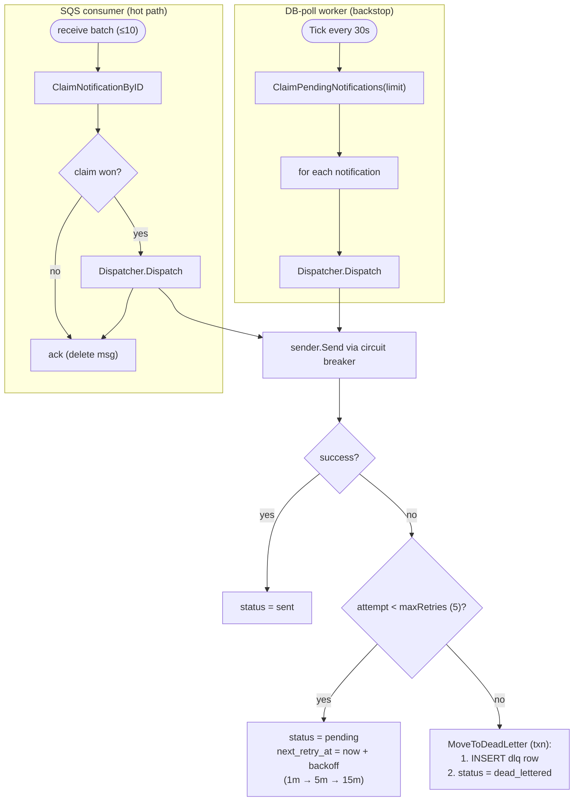

> **Why the poller stays as a backstop:** after dispatching a claimed row, the consumer attempts
> to delete the SQS message. If a send fails with attempts remaining, the dispatcher schedules
> the row as `pending` with a future `next_retry_at`; the DB poller handles that retry. A database
> claim error leaves the SQS message unacknowledged. The poller also finds pending rows whose
> SQS enqueue failed. SQS messages can be redelivered; the notification row remains authoritative.

### Atomic worker claims

The poller selects due notification IDs from the partial eligibility index, using `LIMIT` and `FOR UPDATE SKIP LOCKED`. It updates those locked rows to processing in the same statement. The database timestamp trigger gives each new claim its timestamp for guarded outcome writes. New work becomes eligible on creation, retries at their schedule, and expired workers five minutes after their last claim. The SQS consumer uses the same cutoff with a primary-key lookup. [Batch query](../internal/db/sql/claim_pending.sql) · [Queue benchmark and plans](performance/worker-claims.md)

### The external side-effect boundary

A database claim coordinates work; it does not make delivery atomic with PostgreSQL. A provider
may accept a send and then the worker can crash, or its `sent` status write can fail. The database
still shows `processing`, so a later reclamation can send again. A provider timeout can similarly
leave an ambiguous outcome. The dispatcher currently ignores errors from ordinary status-update
calls, which also means persisted attempt counts can lag the actual number of attempts.

The intended flow is therefore **durable acceptance with retryable delivery attempts**, not an
exactly-once external effect or an unconditional eventual-delivery guarantee. The configured
attempt limit bounds the normal recorded retry flow; persistent storage failures can interrupt
that accounting. Receiver-side deduplication using a stable notification ID, or provider-supported
idempotency, would be needed to address duplicate effects. The webhook sender includes
`X-Nimbus-Notification-ID`; accepting that header is not itself deduplication.

---

## 8. Notification State Machine

This graph describes the normal worker transitions on the **notification row**, once outcome
writes succeed. The dead-letter item has its own status (`pending`, `retried`, or `discarded`).

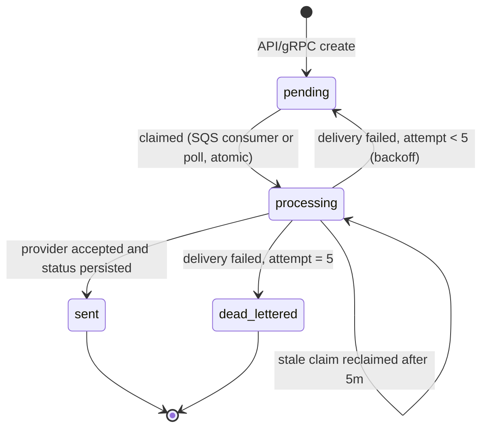

The retry edge `processing → pending` uses scheduled delays of `1m, 5m, 15m`, capped at 15 minutes,
recorded in `next_retry_at`. A due row must still wait for a poll and available worker capacity.
An operator retry creates a **new** notification and marks the DLQ item `retried`; discard marks
the DLQ item `discarded`. Neither operation changes the original notification back to `pending`.

---

## 9. Reliability Patterns

Nimbus combines four reliability mechanisms. Their implementation limits matter when deciding
what workloads and failure cases the project can support.

### 9.1 Idempotency (Redis)

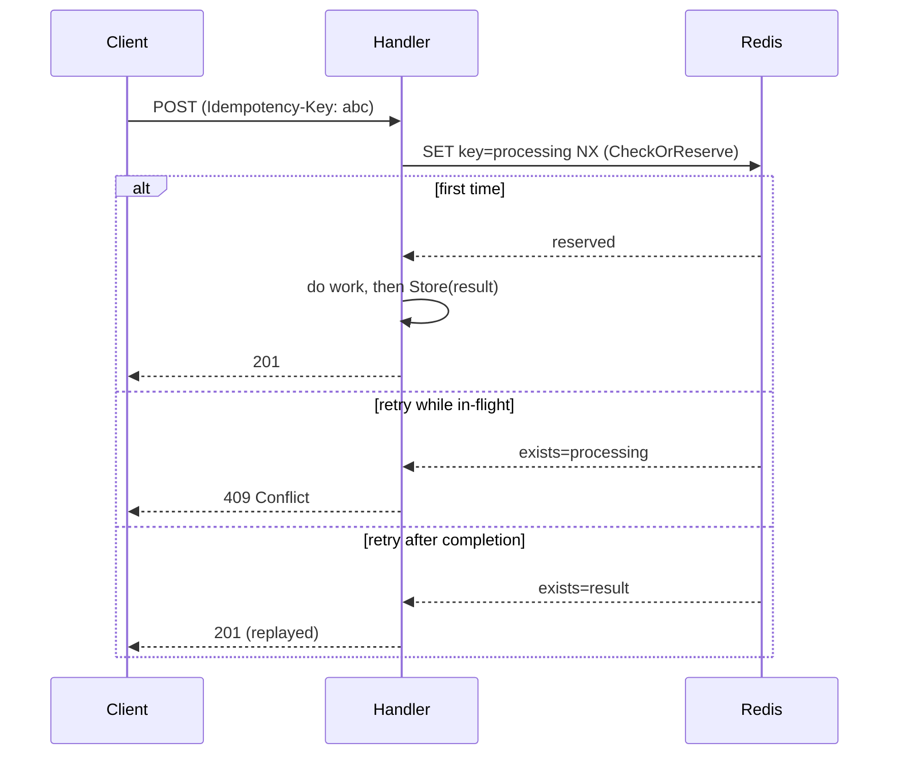

- **Auto keys (5 min TTL):** if the client sends no key, we hash `tenant|user|channel|payload`.
  This catches accidental network retries without blocking intentional re-sends.
- **Client keys (24 h TTL):** an explicit `Idempotency-Key` header retains the cached result longer.
- **Compare-and-delete release:** `Release()` only deletes the key if it's still the `processing`
  marker (Lua comparison), rather than deleting a stored successful response.

This is REST request deduplication, not provider-side delivery deduplication. Redis failures are
handled by continuing without protection. The Redis reservation/result and the Postgres insert
are not one transaction; a crash after insertion but before result caching can leave an ambiguous
client retry. Expired keys permit new requests. gRPC does not use this REST idempotency service.

### 9.2 Sliding-Window Rate Limiting (Redis Sorted Sets)

The default is **100 requests per rolling minute** for the tenant key taken from `X-Tenant-ID`
or the `tenant_id` query parameter. Requests without that key skip the limiter. Timestamps are
stored in a `ZSET`, old entries are trimmed with `ZREMRANGEBYSCORE`, and `ZCARD` counts the window.
The current check and insertion use separate Redis pipelines, so concurrent requests can exceed
the configured limit. A pipeline is not an atomic check-and-add operation.

### 9.3 Circuit Breaker (per channel)

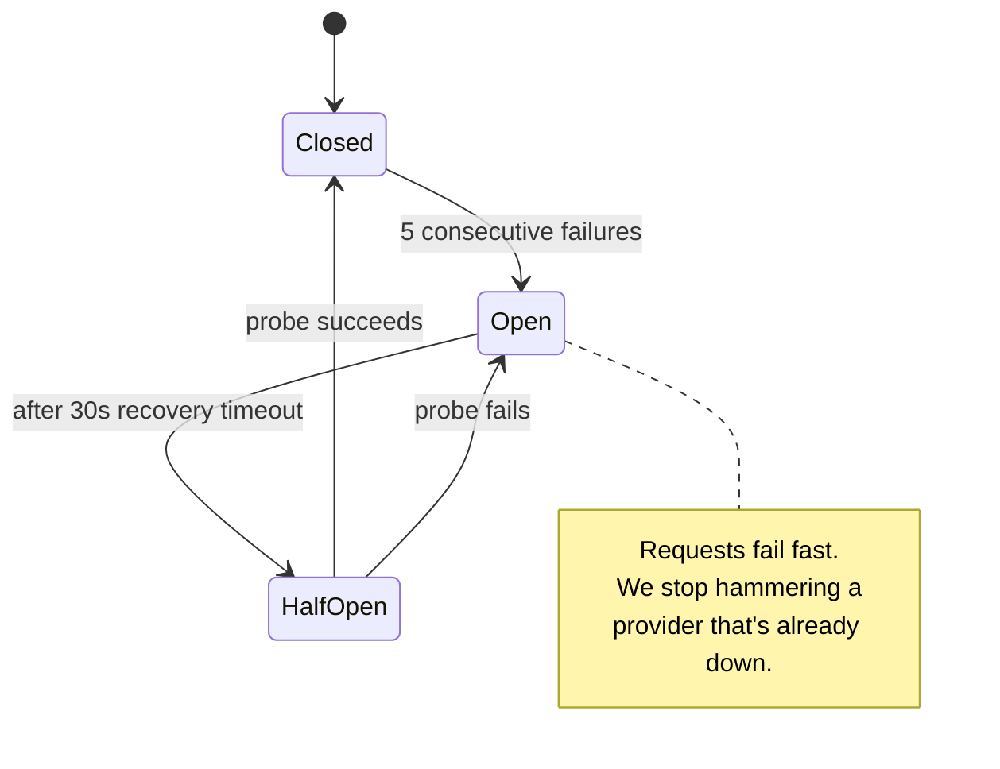

Each sender (SES / SNS / webhook) has its own breaker state. This limits repeated calls to a
failing provider, although channels still share worker resources. `GET /v1/health/circuits`
exposes state; `POST /v1/admin/circuits/{name}/reset` resets the selected breaker.

### 9.4 Dead Letter Queue

When the normal retry flow reaches the configured attempt limit (5 in the gateway), the dispatcher
attempts to move the notification to `dead_letter_notifications` **inside a transaction**: insert
the DLQ row and update the source status together. If that transaction fails, the original row
remains eligible for later stale-claim recovery. Operators can inspect, **retry** (create a fresh
notification), or **discard** via `/v1/dlq` endpoints.

---

## 10. gRPC & Server-Streaming

Internal services use gRPC for typing, efficiency, and — the headline feature — **server-streaming
delivery updates**.

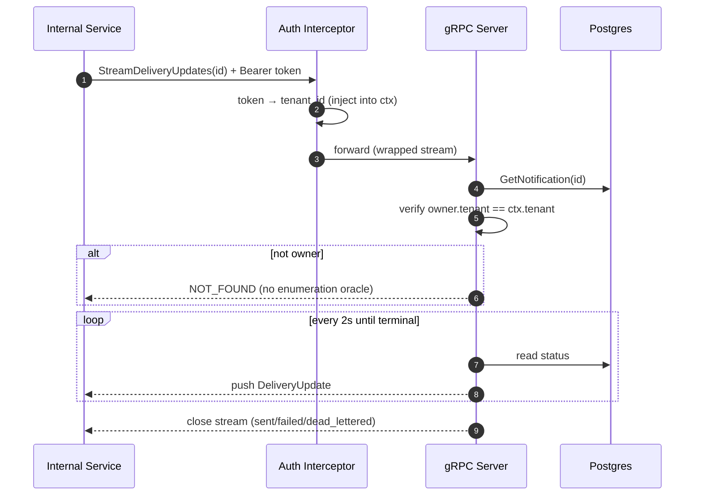

**Streaming tradeoff:** the client keeps one RPC open for delivery updates instead of repeatedly
making get requests. The server still polls the database every two seconds for each active
stream. There is no measured request-reduction percentage or supported concurrent-stream count
published here; both client traffic and database polling load belong in a workload-specific test.

**gRPC authorization:** the tenant is taken from the **authenticated token**, rather than the request
body. Cross-tenant reads return `NOT_FOUND` (not `PERMISSION_DENIED`) so an attacker can't use the
error to discover which IDs exist. This maps to **OWASP API1: Broken Object Level Authorization**.

---

## 11. The AI / RAG Subsystem

Optional (enabled when `OPENAI_API_KEY` is set). Two capabilities:

1. **Compose** (`POST /v1/ai/compose`) — natural language → notifications via LLM function calling.
2. **Ask** (`POST /v1/ai/ask`) — a **Retrieval-Augmented Generation** pipeline that retrieves
   tenant-filtered documents from `knowledge_base` and requests an answer with source references.
   Indexing helpers exist, but successful delivery does not automatically call them in the
   current dispatcher; the knowledge base must be populated separately.

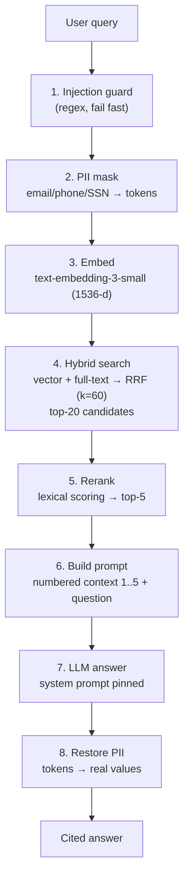

**Design highlights:**

- **Hybrid retrieval + Reciprocal Rank Fusion:** vector similarity and PostgreSQL full-text search
  produce separate rankings. RRF combines them by **rank position**
  ($\text{score}(d) = \sum_i \frac{1}{k + \text{rank}_i(d)}$, $k=60$) so we never need the two systems
  to share a score scale.
- **Two-stage retrieval:** hybrid search returns candidates and a local lexical reranker selects
  up to five. Retrieval quality needs evaluation on representative questions; this is not a
  measured accuracy claim or a neural cross-encoder implementation.
- **Defense in depth:** a regex guard *and* a pinned system prompt. Even if an injection slips past
  the guard, the system prompt instructs the model to ignore instruction-overrides. These are
  mitigations, not proof that prompt injection is prevented.
- **Query masking:** selected patterns in the query are masked before embedding and generation.
  Retrieved document content is also included in the prompt and is not covered by that query-only
  masking step; this does not establish that no sensitive data reaches the external API.
- **pgvector over a dedicated vector DB:** we already run Postgres, so we get ACID, one backup
  strategy, and the ability to JOIN vectors with relational data — zero new infrastructure.

---

## 12. Deployment Topology (AWS)

The **Terraform definitions** (`/terraform`) target **ECS Fargate** behind an ALB, with managed
Postgres, Redis, and SQS. This diagram describes those definitions, not an active hosted demo.
The checked-in GitHub Actions workflow currently disables AWS image-publish, migration, and
deployment jobs; its test and build jobs remain enabled.

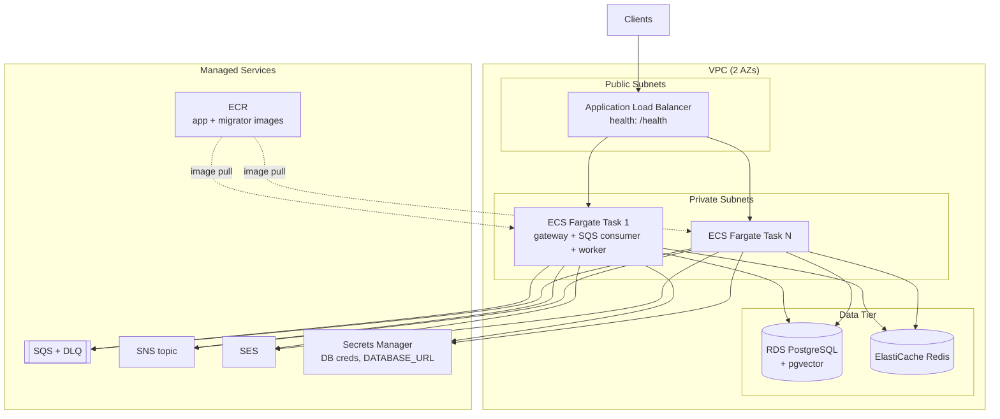

- **Migrations** have a separate ECS task definition and `migrator` image.
- **Secrets** are referenced from Secrets Manager in task definitions. Terraform state can still
  contain values managed by Terraform, so the definitions do not eliminate state-security concerns.
- **GitHub Actions** (`.github/`) runs Go tests and builds the binary. The disabled AWS jobs show
  the deployment workflow; they do not demonstrate a currently running service.

---

## 13. Scaling & Capacity Planning

| Dimension | Current implementation | What to evaluate before scaling |
|---|---|---|
| **API throughput** | HTTP and gRPC share a process and database pool | Measure database latency, pool pressure, payload sizes, and downstream enqueue time before adding replicas. |
| **Delivery throughput** | SQS receive loops plus a sequential batch poller | Measure provider latency, quotas, retry load, and claim contention. Increasing concurrency also increases pressure on shared dependencies. |
| **Database** | PostgreSQL stores pending work and outcomes | Measure claim/update queries and backlog age; evaluate availability and retention requirements. |
| **Rate-limit / idempotency** | Tenant-keyed Redis data | Address concurrent rate-limit checks and fail-open behavior before claiming strict distributed enforcement. |
| **Vector search** | HNSW and full-text indexes in PostgreSQL | Benchmark the actual corpus, recall target, vector dimensions, and memory budget. No fixed vector-count ceiling is established here. |

**Illustrative workload math:** 100,000 notifications/day is about 1.16 requests/second on average;
a hypothetical 10× burst is about 11.6/second. This converts a workload assumption into a rate,
not measured Nimbus capacity. A reliable capacity result needs a reproducible workload,
environment, duration, concurrency, latency percentiles, error counts, and observed backlog.

The tests in `internal/sqs/producer_bench_test.go` measure local message construction and JSON
serialization. They exclude the HTTP path, database writes, Redis, AWS transport, and provider
delivery. Optional local-emulator timing is also not a production AWS SLA.

---

## 14. Failure Modes & Mitigations

| Failure | Effect | Handling and remaining limit |
|---|---|---|
| SQS unavailable | REST enqueue call can add latency; event-driven pickup unavailable | Enqueue errors are logged; the DB poller can claim stored due rows, subject to worker capacity and database/provider availability. |
| Redis unavailable | degraded | Idempotency + rate limiting disabled, requests still served (logged warn). |
| A provider (e.g. SES) down | Failed attempts and shared worker pressure | Per-channel breaker state reduces repeated calls; bounded retries can end in DLQ. |
| Worker/consumer crash mid-send | Delivery outcome may be ambiguous | A row in `processing` is reclaimable after 5 minutes. A provider may already have accepted the first send, so reclamation can duplicate the effect. |
| SQS redelivers an already-sent message | none | `ClaimNotificationByID` returns "not claimable"; the consumer just acks — no re-send. |
| Poison notification (always fails) | Repeated failed attempts | Moves to DLQ after the normal recorded attempt limit if the transaction succeeds. |
| Duplicate REST client request | May create another row if protection is unavailable | Redis reservations/cached results cover a TTL; Redis failure, expiry, and DB/cache crash gaps remain. |
| Concurrent delivery paths | Both may attempt a claim | Database claims coordinate active work; stale reclamation and external sends still need duplicate-effect handling. |
| Outcome write fails | Status/attempt count can lag the external action | The dispatcher currently ignores ordinary status-write errors; stale recovery may reattempt the send. |
| Prompt injection (AI) | Model output may be affected | Regex checks and instructions are mitigations, not a complete defense. |
| Sensitive retrieved content | Content may be sent to the external API | Query masking does not sanitize every retrieved document. |

---

## 15. Key Design Decisions & Tradeoffs

> Each decision below names the alternative that was considered and the cost that was accepted.

| Decision | Why | Tradeoff we accepted |
|---|---|---|
| **Durable row before enqueue** | Pending work survives a failed SQS enqueue without a DB/queue distributed transaction | HTTP still waits for the enqueue attempt; accepting work is separate from delivering it |
| **SQS pickup plus DB polling** | Event-driven pickup and a path for due retries or missed enqueues | Two paths to coordinate; the poller must have enough capacity for the backlog |
| **DB-as-queue with `SKIP LOCKED`** | Coordinates claims using existing PostgreSQL | Database work and polling overhead; claims do not remove the external-side-effect crash window |
| **Two ports: REST :8080 + gRPC :9090** | Clean protocol separation; no h2c multiplexing complexity | Two listeners to operate |
| **Per-channel circuit breakers** | Isolate provider failures | More breaker state to monitor |
| **Idempotency in Redis, not DB unique constraint** | Cached responses and TTL-based expiry | Fail-open behavior and a DB/cache consistency gap |
| **pgvector, not a separate vector store** | Reuses PostgreSQL for vectors and relational data | Shares database resources; corpus-specific evaluation is needed |
| **Hybrid search + RRF** | Robust across semantic *and* keyword queries | Slightly more complex SQL than pure-vector |
| **Server-streaming gRPC for status** | One long-lived client RPC | The server still polls the DB per stream; REST clients use get requests |
| **`NOT_FOUND` on cross-tenant gRPC access** | Avoids distinguishing another tenant's existing record | REST does not currently implement equivalent authorization |

---

## 16. Design Principles Summary

The core principles that drive the system's design:

- **Persist work before attempting delivery.** PostgreSQL stores pending work and recorded outcomes.
- **Keep a recovery path independent of SQS.** Polling finds due database rows even without a queue
  message, while SQS provides an event-driven pickup path.
- **Separate request deduplication from delivery effects.** Redis caching and database claims solve
  different problems; neither makes an external send atomic with a status write.
- **Make recovery limits explicit.** Stale claims can be reclaimed, but ambiguous provider outcomes
  can duplicate effects and failed status writes can leave attempt accounting behind.
- **Describe tenant boundaries by interface.** gRPC has token-based checks; REST needs equivalent
  authentication and authorization before untrusted use.
- **Measure before making capacity claims.** Local serialization benchmarks and hypothetical rate
  calculations do not establish service throughput, latency, or an SLA.

---

*See also: [README](../README.md) for quick start, and [API Reference](API.md) for endpoint and
gRPC contract details.*
